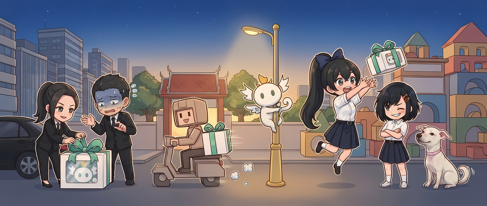
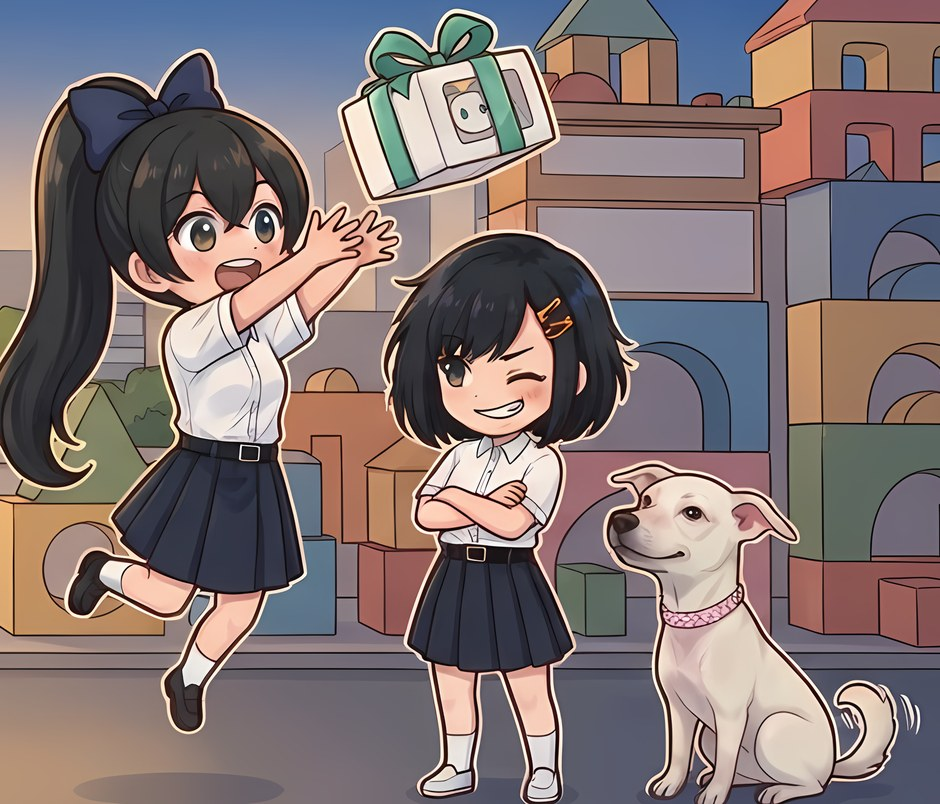
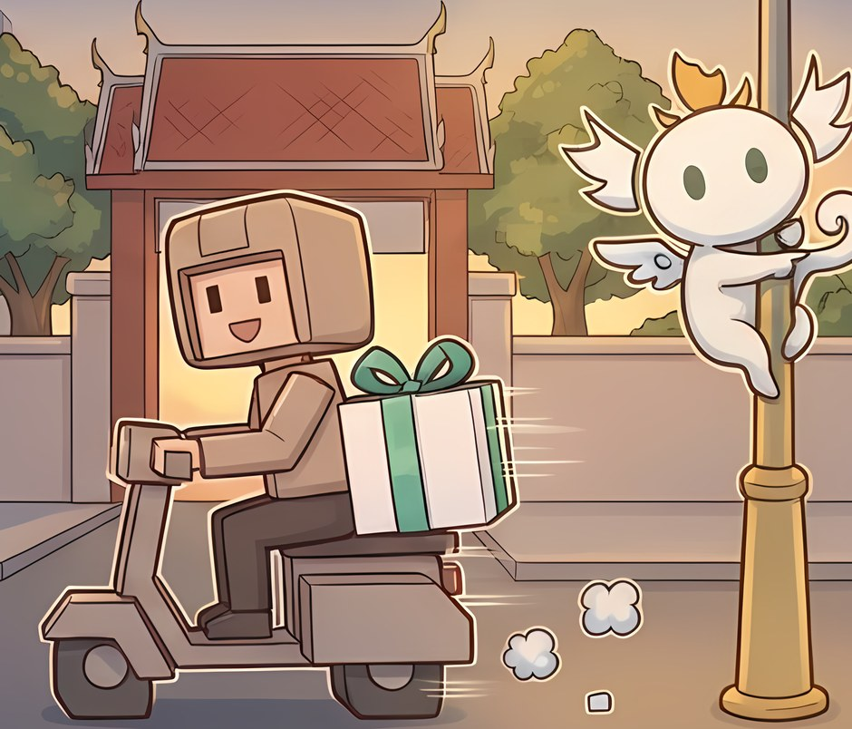

  

<h3 align="center">AETERNA Game · สตูดิโอเกมไทย</h3>

  เราสร้างโลกให้คนไทยเล่นด้วยกัน ทั้งเมือง roleplay บน FiveM, visual novel ภาษาไทย และเกมบน Roblox 
  แล้วเปิดโค้ดเครื่องมือที่ใช้เองให้ชุมชนใช้ฟรี 
  A Thai game studio building worlds to play together: FiveM roleplay, Thai visual novels and Roblox, plus the open-source tools we make along the way.

  
  

## เกมของเรา · Our games

<table>
  <tr>
    <td width="33%" valign="top">
       
      <b>Nakara City</b> 
      เมือง roleplay บน FiveM (GTA V) 
      <i>เมืองคงอยู่ชั่วนิรันดร์ แต่คุณไม่</i> 
      Early Access · <a href="https://nakara-city.com">nakara-city.com</a>
    </td>
    <td width="33%" valign="top">
       
      <b>Visual novel ภาษาไทย</b> 
      เรื่องราววัยเรียน ทำด้วย Ren'Py 
      เร็ว ๆ นี้บน Steam · Coming soon
    </td>
    <td width="33%" valign="top">
       
      <b>Roleplay บน Roblox</b> 
      เมืองให้เล่นด้วยกัน ได้ทั้งมือถือและ PC 
      กำลังพัฒนา · In development
    </td>
  </tr>
</table>

## เบื้องหลังสตูดิโอ · Inside the studio

<table>
  <tr>
    <td width="50%" valign="top"><b>ทีมเล็ก พลัง AI เต็มสตูดิโอ</b> เอเจนต์ AI หลายตัวเขียน ตรวจ และทดสอบงานคู่กับเราทุกวัน ส่วนคนเป็นผู้ตัดสินทุกชิ้นงาน A small team running a studio of AI agents, with people making every call.</td>
    <td width="50%" valign="top"><b>เซิร์ฟเวอร์ตัดสิน ไม่ใช่เครื่องผู้เล่น</b> ระบบเกมออกแบบให้โกงยากตั้งแต่บรรทัดแรก และมีทีม security ของเราเอง Server-authoritative by design, with an in-house security team.</td>
  </tr>
  <tr>
    <td valign="top"><b>หนึ่งทีม สามโลก</b> FiveM · Ren'Py · Roblox ใช้มาตรฐานเดียวกัน ของที่ทำได้ดีในเกมหนึ่ง ย้ายไปอีกเกมได้ทันที One team, three engines, one standard.</td>
    <td valign="top"><b>ไทยเต็มตัว</b> ตัดคำ ฟอนต์ และ UI ภาษาไทย เราทำเองทุกชิ้น Thai-first, from line breaking to fonts.</td>
  </tr>
</table>

## Open source

| | |
|---|---|
| **[Rongroi](https://github.com/aeterna/aeterna-rongroi)**   โปรแกรมเช็คเครื่อง FiveM ฟรี ทำงาน offline แสดงหลักฐานให้ดู ไม่ตัดสินแทนว่า "เครื่องสะอาด"   Free offline FiveM PC check & screenshare tool · Rust + Tauri |      [คู่มือ · Docs](https://aeterna.github.io/aeterna-rongroi/) |
| **[nakara-oss](https://github.com/aeterna/nakara-oss)**   resource และเครื่องมือ dev สำหรับ FiveM ที่ใช้จริงใน Nakara City ทุก release ประกาศสิทธิ์ที่ใช้ สแกนความปลอดภัย และลงลายเซ็นรับรอง   Open-source FiveM resources & devkit · MIT |   |

ติดตามงานใหม่ หรืออยากร่วมงาน · มาคุยกันใน <a href="https://discord.gg/eZ8CNrGe2b">Discord</a>

